# Enterprise Integration Patterns

**1. What is a Message Channel?**

* A Message Channel is the logical communication path through which applications exchange messages.
* The sender writes to the channel without needing to know which consumer receives the message. 
* This reduces temporal and location coupling.
* Examples include a Kafka topic, RabbitMQ queue/exchange topology, AWS SQS queue, or Azure Service Bus queue/topic.
* Senior-level follow-up: 
  * A channel doesn't automatically mean loose coupling. 
  * Producer and consumer can still be strongly coupled through schemas, ordering assumptions, partitioning strategy, 
  timing assumptions, or business semantics.

**2. What is the difference between Point-to-Point and Publish-Subscribe?**

* In a Point-to-Point Channel, a message is normally processed by one consumer. 
* Multiple consumers can compete for work, but each message represents one unit of work.
* In Publish-Subscribe, a message is made available to multiple interested subscribers.
* Think:
  * `Command → usually point-to-point`
  * `Event → often publish-subscribe`
* A common interview mistake is saying "Kafka is pub/sub and RabbitMQ is point-to-point." 
* Both technologies can implement multiple messaging models depending on configuration.

**3. What is a Message Router?**

* A Message Router determines where a message should go without changing the fundamental business responsibility of the sender.
* Conceptually:
```
Producer
|
v
Router
/ |  \
A  B   C
```
* This prevents producers from containing routing knowledge about every downstream system.
* Examples include Content-Based Router, Message Filter, Recipient List, Splitter and Aggregator.

**4. Explain the Content-Based Router.**

* A Content-Based Router examines message content or metadata and selects the destination.
* For example:
```
Order
|
v
Router
|
+-- country=PL --> EU fulfillment
|
+-- country=US --> US fulfillment
|
+-- otherwise --> Global fulfillment
```
* The main risk is allowing the router to become a giant centralized business-rules engine. 
* Routing logic should remain understandable, testable and operationally observable.

**5. What is a Message Filter?**

* A Message Filter removes messages that a consumer or processing path does not need.
* For example, an analytics pipeline might consume only:
```
OrderCompleted
```
* while ignoring:
```
OrderStarted
OrderValidated
OrderCancelled
```
* An important operational question is what "discard" means. 
* Sometimes the message can genuinely disappear; sometimes it should be audited, redirected or sent to another channel.

**6. What is a Recipient List?**

* A Recipient List dynamically determines multiple destinations for a message.
* For example:
```
OrderPlaced
|
Recipient List
/    |      \
CRM Fraud Analytics
```
* Unlike simple publish-subscribe, the recipients may be calculated dynamically from message content or business rules.

**7. Explain Splitter and Aggregator.**

* A Splitter converts one composite message into multiple smaller messages.
```
Order
|
Splitter
|
+--> Item A
+--> Item B
+--> Item C
```
* An Aggregator performs the opposite operation:
```
Result A \
Result B ---> Aggregator ---> Combined Result
Result C /
```
* The Aggregator is substantially harder because it must determine:
  * which messages belong together;
  * when the group is complete;
  * what happens when one message never arrives;
  * where intermediate state is stored;
  * how duplicates are handled;
  * what happens after restart.
* These are exactly the kinds of questions I'd expect in a senior interview.

**8. What is a Correlation Identifier?**

* A Correlation Identifier allows related messages to be associated.
* For example:
```
Request
messageId = 123

Response
correlationId = 123
```
* Correlation IDs are especially important with asynchronous request-response, Splitter/Aggregator flows, long-running 
workflows and distributed tracing.
* A senior engineer should distinguish message ID, correlation ID, business/entity ID, and trace ID. 
* They solve related but different problems.

**9. What is a Message ID?**

* A Message ID uniquely identifies a particular message instance.
* For example:
```
messageId: 93af...
orderId: 92871
correlationId: 71bc...
```
* `orderId` identifies the business entity.
* `messageId` identifies this particular message.
* `correlationId` associates this message with some larger interaction or conversation.
* This distinction becomes important for deduplication and observability.

**10. What is an Idempotent Receiver?**

 * An Idempotent Receiver ensures that processing the same logical message multiple times has the same business effect 
as processing it once.
* Suppose: `Debit account by €100`, is delivered twice.
* Blindly executing it twice is disastrous.
* A consumer might therefore store a processed message/business-operation identifier and reject duplicates.
* Another technique is designing the operation itself to be naturally idempotent: `Set order status = SHIPPED`, instead of:
`Increment shipment counter`.

**11. Why is idempotency so important in messaging systems?**

* Because duplicate delivery is normal in many reliable distributed systems.
* Consider:
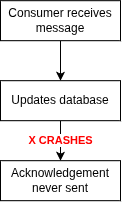
* The broker may redeliver the message.
* Therefore:
  * "The broker delivered the message twice" does not necessarily mean the messaging system malfunctioned.
* It may be the expected consequence of reliable delivery.

**12. What does "exactly once" mean?**

* This is a classic senior-level trap.
* "Exactly once" has to be defined relative to a particular boundary. 
* A broker may provide exactly-once processing semantics for certain operations while the entire business transaction 
still isn't exactly once.
* For example:
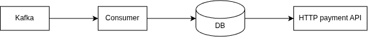
* Exactly-once semantics inside Kafka don't automatically make the database write and external HTTP payment exactly once.
* The better interview answer is:
  * First define exactly once with respect to what observable side effect.
* Then discuss idempotency, deduplication, transactions and transactional boundaries.

**13. What is a Dead Letter Channel?**

* A Dead Letter Channel stores messages that cannot be successfully delivered or processed.
* For example:
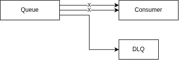
* But creating a DLQ isn't sufficient.
* A senior design must answer:
  * Who monitors it? How are messages inspected? How are they replayed? Has the underlying problem been fixed? 
  Can replay cause duplicate side effects? How long are messages retained?
* A DLQ without an operational process is often just a place where failures disappear.

**14. What is a Retry pattern, and when can retries be dangerous?**

* Retry handles transient failures by attempting the operation again.
* Good candidate: `temporary network timeout`.
* Bad candidate: `invalid customer schema`.
* Retrying malformed data 100 times won't repair it.
* Senior systems usually distinguish:
```
Transient error
-> exponential backoff
-> retry

Permanent/business error
-> error handling / DLQ

Unknown error
-> bounded retry
-> DLQ
```
* Retries can also create retry storms, increasing load on a system that is already failing.

**15. What is a Poison Message?**

* A Poison Message is a message that repeatedly causes processing failure.
* Without special handling:
```
receive
fail
redeliver
fail
redeliver
fail
...
```
* it can block processing or consume significant resources.
* Typical handling is bounded retries followed by quarantine/dead-letter processing.

**16. What is a Competing Consumer?**

* Multiple consumers process messages from the same channel concurrently.
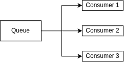
* It is a fundamental horizontal scaling technique.
* But increasing consumer count doesn't guarantee linear scalability. 
* Bottlenecks may move to databases, APIs, partition counts, locks or shared resources.
* Ordering can also become difficult.

**17. How does ordering interact with competing consumers?**

* Global ordering and horizontal parallelism are often in tension.
* If:`OrderCreated`, `OrderPaid`, `OrderCancelled` must be processed in order for a given order, one common solution is 
partitioning by: `key = orderId`.
* Messages for one order remain ordered while different orders can be processed concurrently.
* This is essentially ordering per business key, rather than global ordering.

**18. What is a Message Translator?**

* A Message Translator converts one data representation into another.
* For example:
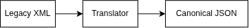
* Translation allows systems to evolve independently, but excessive translation layers can become difficult to understand 
and maintain.

**19. What is the Canonical Data Model?**

* A Canonical Data Model defines a common representation used by integrations.
* Without one, connecting N systems potentially creates many pairwise transformations:
```
A <--> B
A <--> C
A <--> D
B <--> C
...
```
* With a canonical model:
```
A \
B ---> Canonical Model
C /
```
* The advantage is reduced transformation complexity.
* The danger is creating an enormous enterprise-wide "universal schema" that becomes slow to evolve and couples every 
team to a central governance process.
* In modern architectures, bounded-context or domain-specific canonical models are often more practical.

**20. What is an Envelope Wrapper?**

* An Envelope Wrapper adds transport or integration metadata around business data.
* For example:
```json
{
  "messageId": "...",
  "correlationId": "...",
  "timestamp": "...",
  "type": "OrderPlaced",
  "version": 3,
  "payload": {
    "orderId": "123"
  }
}
```
* The envelope separates messaging concerns from business payload.

**21. What is Claim Check?**

* Instead of sending a large payload through the messaging infrastructure, store the data externally and send a reference.
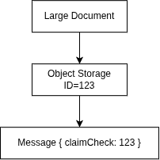
* Useful for large files and payloads.
* Trade-offs include lifecycle management, security, consistency, permissions and the possibility that the referenced 
data disappears before the message is processed.

**22. What is Return Address?**

* Return Address tells the receiver where to send a reply.
* It's especially useful in asynchronous request-reply messaging: `Request: replyTo = response.queue.123`.
* The receiver doesn't need hardcoded knowledge about the caller.

**23. What is Request-Reply messaging?**

* A sender sends a message and expects a corresponding response.
* Unlike HTTP request-response, messaging can make the interaction asynchronous.
* Usually you need:
```
Request Queue
Correlation ID
Return Address
Response Queue
Timeout
```
* A strong senior answer should mention that request-reply over messaging can accidentally recreate synchronous RPC with 
significantly more complexity.

**24. When should you NOT use asynchronous messaging?**

* Messaging isn't automatically better than synchronous communication.
* Avoid introducing it when the interaction is naturally synchronous, immediate consistency is required, the added 
operational complexity isn't justified, or simple HTTP/RPC solves the problem adequately.
* Messaging introduces challenges around eventual consistency, debugging, duplicate processing, ordering, observability, 
schema evolution and operational infrastructure.
* Senior engineers should be able to argue against messaging when appropriate.

**25. What is Eventual Consistency?**

* Different systems don't necessarily observe a state change simultaneously.
* For example:
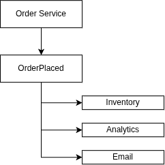
* At time `T`, Order Service may say `PLACED` while Inventory hasn't processed the event yet.
* Eventually the systems converge.
* The important senior question isn't merely "do we use eventual consistency?" but:
> What inconsistency window is acceptable to the business?

**26. How would you handle a database update plus message publication?**

* Suppose:
```
BEGIN
UPDATE orders ...
COMMIT

publish OrderCreated
```
* What happens if the application crashes after the commit but before publishing?
* You have the classic dual-write problem.
* A common modern solution is the Transactional Outbox:
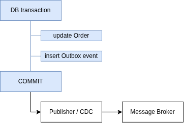
* The database change and creation of the event become one atomic transaction.
* Transactional Outbox isn't one of the original EIP patterns under that modern name, but it's a very important extension 
to discuss in interviews.

**27. What problem does a Resequencer solve?**

* Messages may arrive out of order:
```
1
3
2
```
* A Resequencer reconstructs:
```
1
2
3
```
* This requires knowing sequence information and deciding how long to wait for missing messages.
* If message 2 never arrives, the system needs a timeout or other completion rule.

**28. What is a Message Store?**

* A Message Store persists messages so they can be inspected, audited, replayed or correlated.
* Persistence is especially useful for long-running processes and troubleshooting.
* But retention has costs: storage, privacy/security concerns, compliance requirements and lifecycle management.

**29. What is a Wire Tap?**

* Wire Tap sends a copy of a message to a secondary destination without changing the main flow.
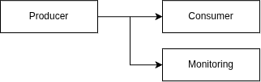
* Typical uses include monitoring, auditing, debugging and analytics.
* The secondary path should ideally not affect the primary processing path.

**30. What is a Control Bus?**

* A Control Bus uses messaging to manage and monitor the messaging infrastructure itself.
* It separates: `Business messages`, from: `Control/management messages`.
* Examples include dynamically changing configuration, querying system state or controlling integration components.

**31. How would you design a reliable payment-processing consumer?**

* This is a great senior interview scenario.
* I'd assume messages can be duplicated and processing can fail at arbitrary points.
* Conceptually:
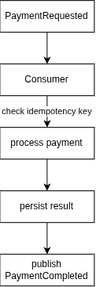
* I would specifically consider idempotency, transactional boundaries, retry policy, DLQ, correlation IDs, 
external-payment-provider idempotency keys, timeouts, observability and recovery/reconciliation.
* The important point is that "the queue guarantees delivery" is nowhere near enough to guarantee correct payment processing.

**32. How would you debug "some messages disappeared"?**

* Don't immediately assume the broker lost them.
* Trace the complete message lifecycle:
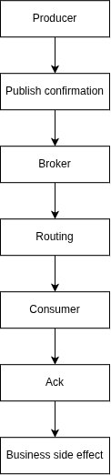
* Then check message IDs/correlation IDs, producer acknowledgements, routing rules, retention, consumer acknowledgements, 
DLQs, filters, TTLs, consumer logs and business persistence.
* Senior engineers investigate end-to-end message flow, rather than only looking at broker metrics.

**33. How do you version message schemas?**

* Prefer backward/forward-compatible evolution where possible.
* For example, adding an optional field is usually safer than changing the semantic meaning of an existing field.
* Consumers should ideally follow the Tolerant Reader principle: depend only on fields they actually require and tolerate 
irrelevant additions.
* Schema registries can enforce compatibility, but technical schema compatibility doesn't guarantee semantic compatibility.
* Changing: `amount = gross amount`, to mean: `amount = net amount`, may be structurally compatible while completely breaking consumers.

**34. Commands vs Events — what's the difference?**

* A command expresses intent:
  * ChargeCustomer.
  * ShipOrder.
  * GenerateInvoice.
* An event states something that happened:
  * CustomerCharged.
  * OrderShipped.
  * InvoiceGenerated.
* Commands usually have an intended receiver.
* Events describe facts and may have zero, one or many consumers.
* This distinction helps avoid turning an event architecture into hidden RPC.

**35. What is coupling in messaging systems?**

* A good senior answer recognizes several dimensions:
  * Location coupling.
  * Temporal coupling.
  * Schema coupling.
  * Semantic coupling.
  * Platform coupling.
  * Operational coupling.
* Messaging often reduces location and temporal coupling.
* It does not automatically remove semantic or schema coupling.
* For example, 30 consumers depending on every detail of an `OrderCreated` schema creates significant coupling even 
though none knows the producer's IP address.

**36. What's wrong with a "smart integration bus"?**

* Putting transformation, orchestration and business logic into one central integration layer can produce:
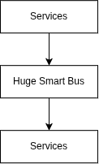
* Eventually the bus becomes the application.
* Changes require centralized coordination and teams lose autonomy.
* A healthier principle is often:
> Keep infrastructure generic and put domain intelligence close to the domain that owns it.

**37. Choreography vs orchestration?**

* With orchestration, a coordinator explicitly controls the workflow:
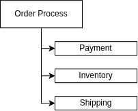
* With choreography:
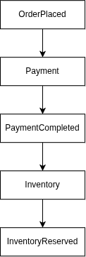
* Choreography reduces central coordination but can make the overall business process difficult to understand.
* Orchestration makes the workflow explicit but introduces a coordinator and potential coupling to it.
* For senior roles, avoid claiming one is universally superior.

**38. How do you observe an asynchronous system?**

* Logs alone aren't enough.
* I'd normally want correlation/trace IDs propagated through messages, structured logs, distributed tracing, 
queue/topic lag, throughput, processing latency, error/retry rates, DLQ size, consumer health and business-level metrics.
* You want to be able to answer:
```
What happened to Order 84721?
```
* without manually searching ten unrelated systems.

**39. Why is backpressure important?**

* Imagine:
```
Producer: 50,000 msg/sec
Consumer: 10,000 msg/sec
```
* The system accumulates:
```
40,000 msg/sec
```
* A broker provides buffering, but buffering isn't infinite scalability.
* A senior design considers consumer scaling, partitioning, rate limiting, queue limits, load shedding, 
downstream capacity and acceptable lag.
* The business question is often:
> How far behind are we allowed to become?

**40. What's the difference between technical and business failures?**

* Technical failure:
  * Connection timeout.
  * Database unavailable.
  * 503 response.
* Often retryable.
* Business failure:
  * Insufficient funds.
  * Order already cancelled.
  * Invalid account.
* Usually retrying won't help.
* Treating both identically creates endless retries and noisy DLQs.

**41. We consume OrderPlaced. We update our database and acknowledge the message. Occasionally customers report missing 
orders. How would you investigate and redesign this?**

* Walk through failure points:
```
OrderPlaced
  |
  v
Receive
  |
  v
Validate
  |
  v
DB transaction
  |
  v
Side effects
  |
  v
ACK
```
* What happens if the process dies after each individual step?
* For example:
```
DB commit
  |
  X crash
  |
ACK never happens
```
* → duplicate delivery.
* Versus:
```
ACK
  |
  X crash
  |
DB update never happens
```
* → potential data loss.
* From there discuss acknowledgement timing, idempotent consumers, transaction boundaries, retries, DLQ, 
Outbox/Inbox patterns, reconciliation and observability.
* That style of reasoning is much more valuable in a senior interview than memorizing 50 pattern definitions.
* A useful mental model for the interview.
* For almost every messaging architecture question, run through:
```
Delivery → Ordering → Duplication → Failure → Consistency → Scalability → Observability → Recovery.
```
* If an interviewer proposes:
> Service A → Kafka → Service B → Database
* your internal checklist should immediately become:
  * What happens if A fails? 
  * What if publish succeeds but A doesn't know? 
  * What if B gets the message twice? 
  * What if B dies halfway through? 
  * What if messages arrive out of order? 
  * What if the DB is unavailable? 
  * What if B is slower than A? 
  * How do we find one specific message? 
  * How do we replay safely?
* That's the level of reasoning that turns Enterprise Integration Patterns from a pattern catalog into senior-level 
system design knowledge.

***

## Enterprise Integration Patterns (EIP) are reusable architectural patterns for solving common problems when multiple applications communicate through messages.

* They give architects and engineers a shared vocabulary. 
* Instead of saying, “We need a component that looks at the message and decides which queue to send it to,” you can say, 
“Use a Content-Based Router.”
* From Enterprise Integration Patterns by Gregor Hohpe and Bobby Woolf, some of the most important patterns are:
* Messaging Channels: 
  * Point-to-Point Channel. 
  * Publish-Subscribe Channel. 
  * Dead Letter Channel. 
  * Guaranteed Delivery.
* Message construction: 
  * Message. 
  * Command Message. 
  * Document Message. 
  * Event Message. 
  * Request-Reply. 
  * Correlation Identifier. 
  * Return Address. 
  * Message Expiration.
* Message routing: 
  * Content-Based Router. 
  * Message Filter. 
  * Recipient List. 
  * Splitter. 
  * Aggregator. 
  * Resequencer. 
  * Routing Slip. 
  * Process Manager.
* Message transformation: 
  * Message Translator. 
  * Envelope Wrapper. 
  * Content Enricher. 
  * Content Filter. 
  * Claim Check. 
  * Normalizer. 
  * Canonical Data Model.
* Messaging endpoints: 
  * Messaging Gateway. 
  * Messaging Mapper. 
  * Transactional Client. 
  * Polling Consumer. 
  * Event-Driven Consumer. 
  * Competing Consumers. 
  * Message Dispatcher. 
  * Selective Consumer. 
  * Durable Subscriber. 
  * Idempotent Receiver.
* System management: 
  * Control Bus. 
  * Wire Tap. 
  * Message History. 
  * Message Store. 
  * Smart Proxy.
  * Detour.
* For a senior interview, I'd especially know these well:
  * Content-Based Router → Splitter → Aggregator → Message Translator → Canonical Data Model → Dead Letter Channel → 
  Competing Consumers → Idempotent Receiver → Correlation Identifier → Publish-Subscribe → Guaranteed Delivery → Message Store.
* For example, an order-processing integration could combine several EIPs:
```
                         ┌─> Payment Service
                         │
OrderPlaced ─> Router ───┼─> Inventory Service
                         │
                         └─> Shipping Service
                                |
                              failure
                                ↓
                          Dead Letter Channel
```
* The key idea is that EIP isn't one architecture or technology. 
* It's a vocabulary of patterns that can be implemented using technologies such as Kafka, RabbitMQ, JMS, 
AWS messaging services, Azure Service Bus, Apache Camel, etc.
* A very common senior-interview question is: 
  * “Here is an integration problem. Which EIP patterns would you use, and why?” 
  * That's usually more important than memorizing the full catalog.